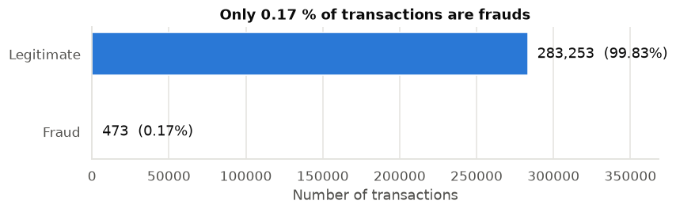
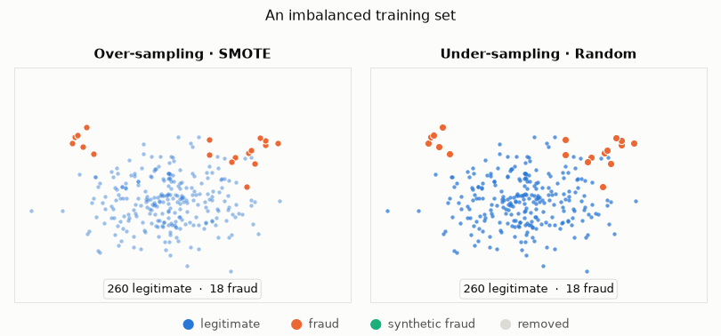
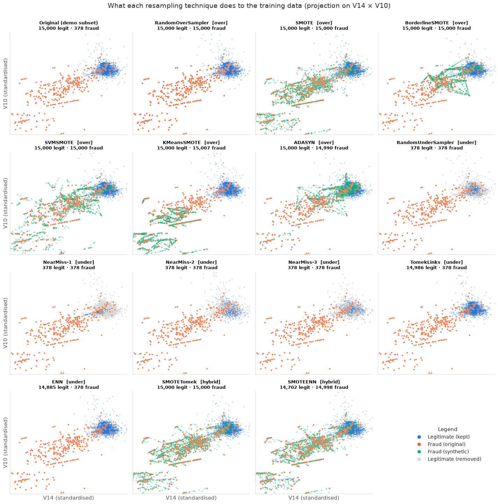
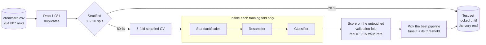
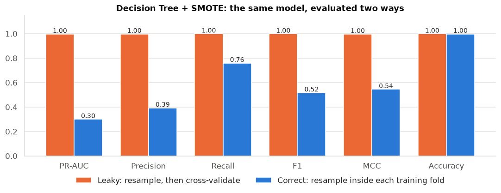
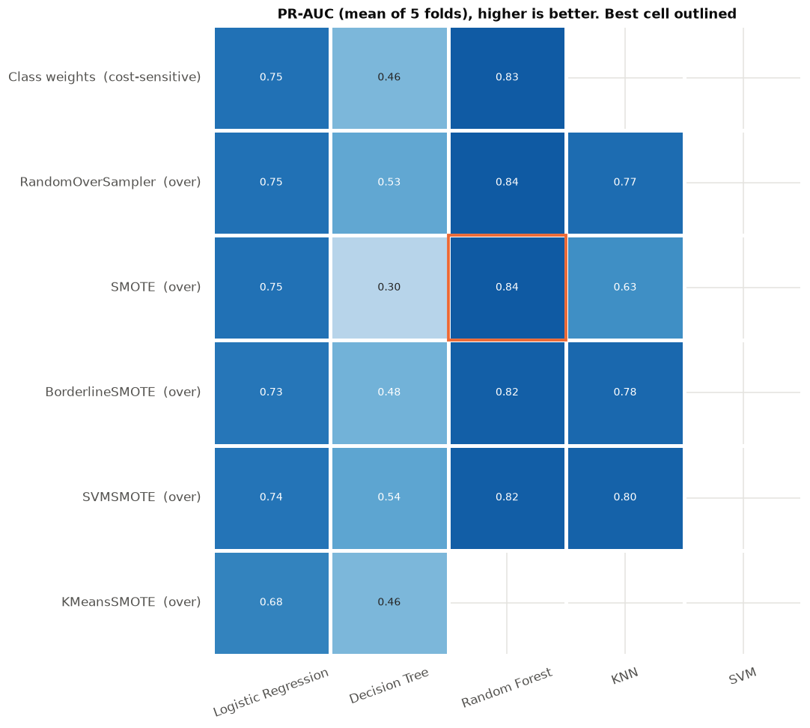
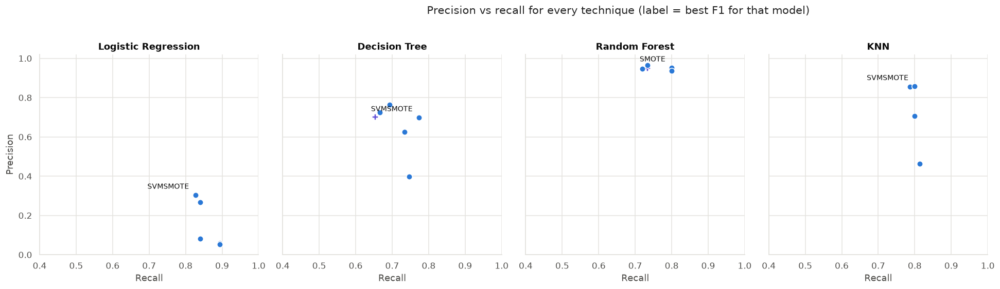
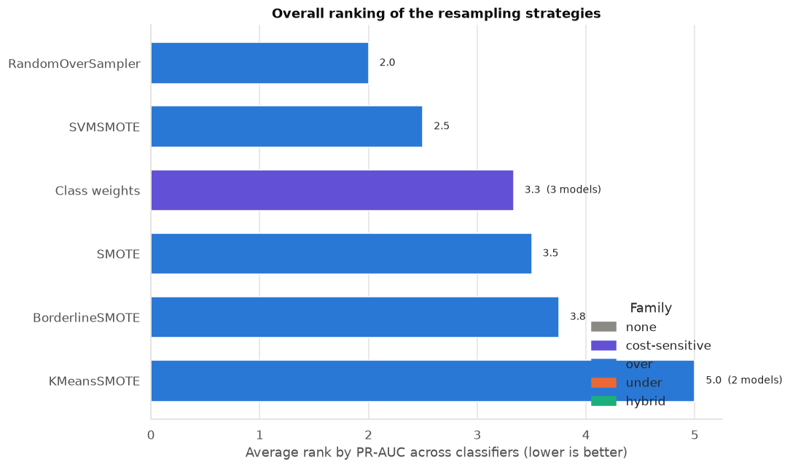

<div align="center">



<br>


**How should you train a classifier when only 1 transaction in 600 is a fraud?**<br>
A benchmark of **16 rebalancing strategies × 5 classifiers** on 284 k real credit-card transactions,
evaluated with a strict leakage-free protocol.

[The problem](#-the-problem) ·
[Techniques](#-resampling-techniques-studied) ·
[Methodology](#-methodology) ·
[Results](#-key-results) ·
[Quick start](#-quick-start) ·
[Structure](#-project-structure)

</div>

---

## 🎯 The problem

Fraud detection is a textbook case of **extreme class imbalance**. In the
[ULB credit-card dataset](https://www.kaggle.com/datasets/mlg-ulb/creditcardfraud), only
**473 of 283 726** transactions (after removing duplicates) are frauds, **0.17 %**.

<p align="center"></p>

That causes three problems:

- **Accuracy is meaningless.** Always answering "legitimate" scores **99.83 %** accuracy and catches no fraud.
- **Models ignore the minority class.** The frauds weigh too little in the training loss to shape the decision boundary.
- **There are very few examples to learn from**, so the fraud region of the feature space is sparsely described.

**Resampling** changes the class distribution of the *training* data, either by creating frauds or by removing
legitimate transactions. This project measures which techniques actually help, for which models, and at what cost.

<p align="center">
  
</p>

---

## 🧪 Resampling techniques studied

| Family | Technique | Idea |
|---|---|---|
| ⚪ **Baseline** | No resampling | Train on the raw, imbalanced data |
| 🟣 **Cost-sensitive** | Class weights | Keep the data, weight each class by its inverse frequency in the loss |
| 🔵 **Over-sampling** | Random Over-Sampler | Duplicate random frauds |
| | SMOTE | Interpolate new frauds between a fraud and its nearest fraud neighbours |
| | Borderline-SMOTE | SMOTE only from frauds close to the decision border |
| | SVM-SMOTE | SMOTE guided by the support vectors of an SVM |
| | K-Means-SMOTE | SMOTE inside k-means clusters dominated by frauds |
| | ADASYN | More synthetic samples for the frauds that are hardest to learn |
| 🟠 **Under-sampling** | Random Under-Sampler | Drop random legitimate transactions |
| | NearMiss-1 / 2 / 3 | Keep only the legitimate transactions closest to frauds (3 definitions of "close") |
| | Tomek Links | Remove legitimate points that form cross-class nearest-neighbour pairs (cleaning) |
| | Edited Nearest Neighbours | Remove legitimate points misclassified by their neighbours (cleaning) |
| 🟢 **Hybrid** | SMOTE + Tomek | Over-sample, then clean the overlap |
| | SMOTE + ENN | Over-sample, then clean more aggressively |

**Classifiers:** Logistic Regression · Decision Tree · Random Forest · K-Nearest Neighbours · SVM (RBF)

<details>
<summary><b>👀 See what every technique does to the data</b></summary>
<br>
<p align="center"></p>
<p align="center"><sub>Synthetic frauds in green, removed legitimate transactions in grey. Generated in <a href="notebooks/02_resampling_techniques.ipynb">notebook 02</a>.</sub></p>
</details>

---

## 🔬 Methodology



- **Resampling happens inside each training fold only**, through an
  [`imblearn.pipeline.Pipeline`](https://imbalanced-learn.org/stable/references/generated/imblearn.pipeline.Pipeline.html).
  The validation and test data keep the real class distribution.
- **Stratified** splits, so every fold keeps its share of the rare frauds. The same folds are used for every combination.
- **Imbalance-aware metrics.** The main metric is **PR-AUC** (average precision). Recall, precision, F1, MCC and ROC-AUC are also reported.
  Accuracy is kept only to show how misleading it is.
- **Default hyper-parameters** in the benchmark, so that the resampling techniques are compared on equal footing.
  Tuning (including *how much* to rebalance) and threshold selection come afterwards, for the best candidate.

---

## 📊 Key results

### 1. Evaluating the wrong way makes any model look perfect

The first version of this project resampled the **whole dataset before** cross-validating.
Evaluating the same Decision Tree + SMOTE both ways shows how far off that is:

| Decision Tree + SMOTE | PR-AUC | Precision | Recall | F1 |
|---|:-:|:-:|:-:|:-:|
| ❌ Resample, *then* cross-validate (leaky) | 0.997 | 0.998 | 0.999 | 0.998 |
| ✅ Resample *inside* each training fold | **0.300** | **0.393** | **0.759** | **0.517** |

<p align="center"></p>

> [!IMPORTANT]
> With leakage, synthetic frauds in the validation folds are interpolations of training frauds, and the folds are 50 % fraud
> instead of 0.17 %. **Never resample before splitting.** Every other number in this project uses the correct protocol.

### 2. Benchmark: 16 strategies × 5 classifiers

<p align="center"></p>

<!-- BENCHMARK-TABLE:START -->
| Rank | Technique | Model | PR-AUC | Recall | Precision | F1 |
|:-:|---|---|:-:|:-:|:-:|:-:|
| 🥇 | KMeansSMOTE | Random Forest | 0.853 | 0.780 | 0.951 | 0.857 |
| 🥈 | SMOTE | Random Forest | 0.852 | 0.820 | 0.926 | 0.869 |
| 🥉 | SMOTETomek | Random Forest | 0.852 | 0.820 | 0.926 | 0.869 |
| — | *No resampling (baseline)* | Random Forest | 0.838 | 0.767 | 0.966 | 0.855 |
<!-- BENCHMARK-TABLE:END -->

<sub>Mean over the cross-validation folds of the training set. The complete table is in
<a href="notebooks/03_benchmark.ipynb">notebook 03</a> and <a href="results/cv_benchmark.csv">results/cv_benchmark.csv</a>.</sub>

**What the benchmark shows**

- 🌲 **The choice of model matters more than the choice of sampler.** Random Forest is the best classifier with
  almost every technique, and even *without* resampling it is within a few hundredths of the best PR-AUC.
- ⚖️ **Resampling moves the operating point more than it improves the model.** At the 0.5 threshold it raises
  recall and lowers precision, but it barely improves how well a strong model *ranks* transactions (PR-AUC).
- ⚠️ **Resampling can hurt.** Plain SMOTE lowers the PR-AUC of the Decision Tree and of KNN. Some interpolated frauds
  land inside the legitimate cluster, and these local models learn them as if they were real.
- 🟣 **Class weights and the gentle techniques are the safest bets.** Class weights, Random Over-Sampling,
  SVM-SMOTE and Tomek Links stay close to or above the baseline for every model.
- 🟠 **Aggressive under-sampling backfires.** Random under-sampling and NearMiss keep only about 300 of 180 000 legitimate
  transactions. Recall is high, but precision collapses, which in practice means thousands of false alarms.
- 🧹 **Cleaning methods (Tomek Links, ENN) are harmless but barely change the data.** They remove about 15 and 100
  legitimate transactions respectively.

<p align="center"></p>

<details>
<summary><b>🏆 Overall ranking of the techniques across classifiers</b></summary>
<br>
<p align="center"></p>
</details>

### 3. Final model on the hold-out test set

The best pipeline is tuned, including `sampling_strategy`, which controls *how much* to rebalance.
Its decision threshold is chosen from cross-validated predictions. It is then evaluated **once** on the 56 746
transactions of the test set, against the no-resampling baseline. The test results, confusion matrices and a
business view (frauds caught, € blocked, false alarms per 10 000 transactions) are in
[notebook 04](notebooks/04_tuning_and_final_evaluation.ipynb).

<p align="center"></p>

> [!TIP]
> **Takeaway for practitioners:** start with a strong model (e.g. Random Forest) and an imbalance-aware metric.
> Treat the **decision threshold** as a first-class hyper-parameter. Then try class weights or *moderate* over-sampling
> rather than full 50/50 rebalancing, check that it really beats the baseline, and always resample inside the cross-validation.

---

## 🚀 Quick start

**1. Clone and install**

```bash
git clone <repository-url>
cd Fraude_Detection

conda create -n fraud python=3.12 -y && conda activate fraud   # or: python -m venv .venv
pip install -r requirements.txt
```

**2. Get the data.** Download `creditcard.csv` (150 MB) from
[Kaggle](https://www.kaggle.com/datasets/mlg-ulb/creditcardfraud) and put it in `data/`:

```
data/creditcard.csv
```

**3. Explore the notebooks** in order:

```bash
jupyter notebook notebooks/
```

| # | Notebook | What you will find |
|:-:|---|---|
| 01 | [EDA](notebooks/01_eda.ipynb) | Data quality, class imbalance, time and amount patterns, discriminative features, correlations |
| 02 | [Resampling techniques](notebooks/02_resampling_techniques.ipynb) | Theory of each family and a visual gallery of all 14 samplers on real data |
| 03 | [Benchmark](notebooks/03_benchmark.ipynb) | The leakage pitfall, the 16 × 5 comparison, precision/recall trade-off, ranking and cost |
| 04 | [Tuning & final evaluation](notebooks/04_tuning_and_final_evaluation.ipynb) | Grid search, threshold choice, hold-out test, business impact, feature importance |

**4. (Optional) Re-run the full benchmark.** It takes about 1.5 h on a 12-core laptop. It saves its progress
and can be resumed:

```bash
python scripts/run_benchmark.py              # writes results/cv_benchmark.csv
python scripts/run_benchmark.py --folds 3 --models "Random Forest" "KNN"   # a quicker subset
```

### Use the package in your own code

```python
from fraud_resampling import load_data, train_test_split_stratified, cross_validate_pipeline, build_pipeline

df = load_data()                                            # data/creditcard.csv, duplicates removed
X_train, X_test, y_train, y_test = train_test_split_stratified(df)

# Leakage-free 5-fold CV of any (technique, model) pair
scores = cross_validate_pipeline("SMOTE", "Random Forest", X_train, y_train)
print(scores.loc["mean", ["pr_auc", "recall", "precision", "f1"]])

# Or get the scaler -> sampler -> model pipeline and use it like any scikit-learn estimator
pipe = build_pipeline("BorderlineSMOTE", "Logistic Regression").fit(X_train, y_train)
```

Available techniques: `list(fraud_resampling.SAMPLERS)` · available models: `list(fraud_resampling.MODELS)`

---

## 📁 Project structure

```
Fraude_Detection/
├── fraud_resampling/            # Reusable Python package
│   ├── data.py                  #   loading, duplicate removal, stratified hold-out split
│   ├── samplers.py              #   registry of the 14 resampling techniques + baseline + class weights
│   ├── models.py                #   registry of the 5 classifiers
│   ├── evaluation.py            #   leakage-free CV, benchmark loop, metrics
│   ├── tuning.py                #   grid search over the full pipeline
│   └── plots.py                 #   shared plotting helpers and colour palette
├── notebooks/
│   ├── 01_eda.ipynb
│   ├── 02_resampling_techniques.ipynb
│   ├── 03_benchmark.ipynb
│   └── 04_tuning_and_final_evaluation.ipynb
├── scripts/
│   ├── run_benchmark.py         # full benchmark → results/cv_benchmark.csv
│   └── make_readme_animation.py # regenerates assets/resampling.gif
├── results/cv_benchmark.csv     # cached benchmark results (one row per technique × model × fold)
├── figures/                     # figures exported by the notebooks
├── assets/                      # README banner and animation
├── data/                        # put creditcard.csv here (not versioned)
├── legacy/                      # first version of the project, kept for reference
└── requirements.txt
```

<details>
<summary><b>🛠️ What changed since the first version</b></summary>
<br>

| First version (`legacy/`) | Current version |
|---|---|
| Data resampled **before** cross-validation → scores of ~0.99 | Resampling inside each training fold via an imblearn `Pipeline` |
| Accuracy, precision, recall, F1 | + PR-AUC, ROC-AUC, MCC, balanced accuracy |
| Plain K-fold | **Stratified** K-fold + a hold-out test set |
| No feature scaling | `StandardScaler` before every distance-based step |
| `SVMSMOTE_tec` / `KMeansSMOTE_tec` shadowed the imblearn classes (infinite recursion) | Single registry of techniques |
| `Test_model(..., "Tomeklinks")` imported a function that does not exist | Fixed |
| Grid search with `max_features="auto"` (half of the fits failed) and accuracy scoring | Grid search over the whole pipeline, PR-AUC scoring |
| 1 081 duplicated rows kept | Duplicates removed |

</details>

---

## 🎓 Context

This repository is our **Projet Métier**, an academic machine-learning project on **the data-resampling problem in
fraud detection**. It covers exploratory analysis, the theory and visualisation of resampling techniques, a rigorous
comparative benchmark, and the final model selection.

<!-- Add the team members, supervisor and school here. -->
**Author:** Souhail Housni

## 📚 References

- A. Dal Pozzolo, O. Caelen, R. A. Johnson, G. Bontempi, *Calibrating Probability with Undersampling for Unbalanced Classification*, IEEE SSCI 2015. Source of the dataset.
- N. V. Chawla, K. W. Bowyer, L. O. Hall, W. P. Kegelmeyer, *SMOTE: Synthetic Minority Over-sampling Technique*, JAIR 16, 2002.
- H. Han, W.-Y. Wang, B.-H. Mao, *Borderline-SMOTE*, ICIC 2005 · H. He et al., *ADASYN*, IJCNN 2008.
- I. Mani, I. Zhang, *kNN approach to unbalanced data distributions (NearMiss)*, ICML Workshop 2003.
- G. Lemaître, F. Nogueira, C. K. Aridas, *Imbalanced-learn: A Python Toolbox to Tackle the Curse of Imbalanced Datasets*, JMLR 18, 2017.
- T. Saito, M. Rehmsmeier, *The Precision-Recall Plot Is More Informative than the ROC Plot When Evaluating Binary Classifiers on Imbalanced Datasets*, PLOS ONE, 2015.

<div align="center"><sub>Dataset © ULB Machine Learning Group / Worldline, distributed under the Open Database License (ODbL).</sub></div>
